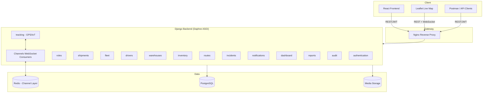

# LogiTrack Pro — Architecture

## High-level architecture

## Request flow (typical write)
1. Client sends `POST` with `Authorization: Bearer <access_token>`.
2. `JWTAuthentication` resolves the user from the token.
3. DRF `ScopedRateThrottle`/`UserRateThrottle` checks rate limits.
4. `HasRolePermission` / `IsAdminRole` checks the user's `Role` and its `Permission`s.
5. Serializer validates input; viewset's `perform_create/update/destroy` runs.
6. If the viewset uses `AuditLogMixin`, an `AuditLog` row is written (who/what/when/from-where).
7. For GPS writes, the view also pushes the update to the relevant Channels group so connected
   WebSocket clients (live map, per-vehicle dashboards) get it instantly — no polling.

## Why a separate Roles app instead of fields on User
Roles and Permissions are modeled as their own tables (`roles.Role`, `roles.Permission`)
rather than boolean flags on `accounts.User`. This lets new roles/permissions be added or
changed at runtime (via the admin or API) without a code change or migration, and keeps
authorization logic (`HasRolePermission`) reusable across every app.

## Async / real-time layer
- **Django Channels** handles WebSocket connections (`config/asgi.py`, `tracking/routing.py`).
- Two consumers: `FleetOverviewConsumer` (all vehicles) and `VehicleTrackingConsumer` (one vehicle).
- In production the channel layer is Redis-backed (`channels_redis`) so multiple Daphne
  workers can share broadcast state; in local dev it falls back to Django's in-memory layer
  (`USE_INMEMORY_CHANNEL_LAYER=True` in `.env`) so no Redis install is required to test.
